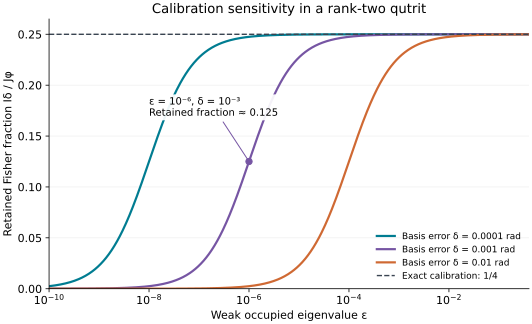

# Measurement resources and calibration

The [construction](construction.md) uses one physical copy per readout and $`2rd-r`$ labeled outcomes. Its uniform Fisher guarantee is calibrated to an eigenbasis of a rank-$`r`$ nominal state. The readout weights need no occupied-eigenvalue input. Their independence of the spectrum does not imply that learning the required calibration has a spectrum-independent finite-sample cost.

See [the model](model.md) for the exact-rank promise, [optimality](optimality.md) for the sharp Fisher fraction, [estimation](estimation.md) for score estimators and pilot calibration, and [related work](../references/RELATED_WORK.md) for the relationship to earlier tomography and Fisher-symmetric measurements.

## Resource accounting

| Resource | Accounting in the theorem |
| --- | --- |
| Specimens | One copy of the unknown state is measured for each outcome. The calibrated POVM does not couple different copies. |
| Outcome alphabet | Exactly $`r[2(d-r)+1]+4\binom r2=2rd-r`$ labeled effects in the displayed construction. |
| Calibration for measurement settings | The exact rank, an orthonormal occupied eigenbasis, and an orthonormal completion in the kernel. |
| Occupied eigenvalues | No eigenvalue enters a POVM coefficient or Fourier phase. |
| Statistical model | The score estimator uses nominal probabilities and model derivatives. These statistical inputs are distinct from the inputs needed to set the physical POVM. |
| Quantum control | Arbitrary single-copy POVMs, including an ancillary implementation, are allowed. Gate depth, geometric locality, control precision, and synthesis time are not constrained. |
| Classical adaptation | A pilot may select the subsequent POVM; all pilot copies are included in the total sample count. |
| Records | Every outcome is retained. There is no successful-shot conditioning or postselection multiplier. |

The outcome count follows from $`r`$ Fourier families with $`2(d-r)+1`$ effects each and four effects for each occupied pair. It is an explicit implementation size, not a minimum-outcome theorem.

For a standard realization, write each rank-one effect as $`E_z=|a_z\rangle\langle a_z|`$. Completeness makes

```math
V=\sum_z |z\rangle\langle a_z|,
\qquad V^\dagger V=\mathbb I,
```

an isometry. An extension of this isometry followed by an ordinary outcome-basis measurement implements the POVM on one specimen, with an ancillary system if needed. The existence of this realization imposes no restriction on the complexity of the extension. In a register with $`d=2^n`$, both the outcome alphabet and a generic basis description can grow exponentially in the number of physical qubits. The result is a copy and Fisher-information statement, not an efficient local-circuit or classical-compilation guarantee.

## What the calibration supplies

At the nominal state

```math
\rho=\sum_{j=1}^{r}\lambda_j|e_j\rangle\langle e_j|,
\qquad \lambda_j\gt 0,
```

the measurement requires the vectors $`e_j`$ to be an eigenbasis of the occupied block, rather than merely an arbitrary basis of its support. Any basis within a degenerate positive eigenspace is valid. The kernel basis is arbitrary, provided it is orthonormal and orthogonal to the support.

The coefficients $`1/(2r)`$, $`1/[r(2(d-r)+1)]`$, and the roots of unity are determined by the rank and dimension. They do not require $`\lambda_j`$. In contrast, a nominal-point score estimator evaluates the model's outcome probabilities and their derivatives. These can be supplied by a calibrated statistical model, or estimated through the pilot procedure described in [estimation](estimation.md#learning-the-calibration-with-a-pilot-sample).

For pilot calibration, the total number of state preparations is

```math
n=n_0+n_1.
```

The displayed pointwise asymptotic protocol takes $`n_0=\lceil n^\alpha\rceil`$ with $`1/2\lt \alpha\lt 1`$. It uses every pilot attempt and every second-stage outcome in its resource accounting. The statement $`n_0/n\to0`$ concerns a fixed dimension, fixed local model, and fixed state with a positive smallest occupied eigenvalue. It does not assign a uniform finite-sample cost to estimating the rank or the eigenbasis over a family approaching a rank boundary.

## Calibration sensitivity for a weakly occupied direction

The effect of a small basis error can be quantified on an actual rank-preserving parameter direction. Assume $`r\ge2`$ and $`d\gt r`$. Let $`e_1`$ and $`e_2`$ be occupied eigenvectors with eigenvalues

```math
\Lambda=\lambda_1\gt 0,
\qquad \varepsilon=\lambda_2\gt 0,
```

and let $`f_1`$ be a kernel vector. The other occupied eigenvectors and eigenvalues are arbitrary. Consider the rank-preserving model in which only the weakly occupied vector rotates:

```math
\begin{aligned}
|\psi_\phi\rangle
&=\cos\phi\,|e_2\rangle+\sin\phi\,|f_1\rangle,\\
\rho_\phi
&=\Lambda|e_1\rangle\langle e_1|
+\varepsilon|\psi_\phi\rangle\langle\psi_\phi|
+\sum_{j=3}^{r}\lambda_j|e_j\rangle\langle e_j|.
\end{aligned}
```

At $`\phi=0`$ the tangent and its quantum Fisher information are

```math
X=\left.\partial_\phi\rho_\phi\right|_{\phi=0}
=\varepsilon\bigl(
|e_2\rangle\langle f_1|+|f_1\rangle\langle e_2|
\bigr),
\qquad J_\phi=4\varepsilon.
```

Now build the POVM in a nominal basis with a small error mixing the strongly occupied vector with the kernel:

```math
\begin{aligned}
|\widetilde e_1\rangle
&=\cos\delta\,|e_1\rangle-\sin\delta\,|f_1\rangle,\\
|\widetilde f_1\rangle
&=\sin\delta\,|e_1\rangle+\cos\delta\,|f_1\rangle.
\end{aligned}
```

All other basis vectors, including $`e_2`$, are unchanged. The rank supplied to the construction is still correct. The measurement is fixed in this nominal basis while $`\phi`$ varies in the true model.

Only two effect families have nonzero derivatives in the chosen direction. The Fourier family attached to $`e_2`$ has common probability

```math
p_{2t}
=\frac{\varepsilon+\Lambda\sin^2\delta}{rN},
\qquad N=2(d-r)+1,
```

and derivatives

```math
\left.\partial_\phi p_{2t}\right|_{\phi=0}
=\frac{2\varepsilon\cos\delta}{rN}
\cos\!\left(\frac{2\pi t}{N}\right).
```

Their Fisher contribution is

```math
I_F
=\frac{2\varepsilon^2\cos^2\delta}
{r(\varepsilon+\Lambda\sin^2\delta)}.
```

The support-pair effects for $`\widetilde e_1,e_2`$ have common probability $`(\varepsilon+\Lambda\cos^2\delta)/(4r)`$. Their real branches carry the remaining derivatives, yielding

```math
I_G
=\frac{2\varepsilon^2\sin^2\delta}
{r(\varepsilon+\Lambda\cos^2\delta)}.
```

All other effects have zero first derivative for this parameter. Thus the exact retained fraction is

```math
\boxed{
\frac{I_\delta}{J_\phi}
=\frac{\varepsilon}{2r}
\left[
\frac{\cos^2\delta}
{\varepsilon+\Lambda\sin^2\delta}
+
\frac{\sin^2\delta}
{\varepsilon+\Lambda\cos^2\delta}
\right].
}
```

Perfect calibration gives $`I_0/J_\phi=1/(2r)`$, as required. If

```math
\varepsilon\ll\Lambda\delta^2,
\qquad \delta^2\ll1,
```

then

```math
\frac{I_\delta}{J_\phi}
\sim \frac{\varepsilon}{2r\Lambda\delta^2}.
```

The relevant leakage parameter is therefore $`\delta^2\Lambda/\varepsilon`$. Taking $`\Lambda=\lambda_{\max}`$ and $`\varepsilon=\lambda_{\min}`$ makes the spectral dependence explicit. Strong-state population of order $`\Lambda\delta^2`$ enters outcomes that ideally have probability of order $`\varepsilon`$, while the derivative for the weakly occupied direction remains proportional to $`\varepsilon`$.

For example, at rank two in dimension three, with $`\varepsilon=10^{-6}`$, $`\Lambda=1-\varepsilon`$, and $`\delta=10^{-3}`$ radians, the retained fraction is approximately $`0.125`$, compared with the ideal $`0.25`$. The loss occurs without postselection or a change of the true rank.



The curves evaluate the exact formula above. The [figure generator and direct-POVM checks](../verification/README.md) reproduce both the curves and the marked example.

This calculation concerns the displayed miscalibrated readout, not an optimal lower bound on calibration sample complexity. For each fixed positive spectrum, its retained fraction tends continuously to the ideal value as the basis error vanishes. It explains the compatibility of a spectrum-independent exact-calibration theorem with a pilot analysis whose finite-sample constants depend on the operating state.

## Strong and weak eigenvector errors

The strong-leakage example above keeps the weak vector fixed. A different error rotates the weak vector into the kernel while leaving the strong vector fixed. Its two weak quadratures have distinct exact formulas and, for small fixed angles, a positive full-matrix limit as the weak occupation vanishes. Strong-state leakage does not describe this second geometry. [Paid calibration](paid-calibration.md#weak-eigenvector-error-has-a-different-limit) gives the formulas, the full seven-dimensional limit, and the large-angle failure boundary.

The same page supplies [complete-record information](paid-calibration.md#model-and-complete-record-information), [scoped geometric calibration lower bounds](paid-calibration.md#geometric-calibration-requirements), and an [exact paid pilot](paid-calibration.md#an-exact-paid-real-angle-pilot). These distinguish the cost of recovering a basis, the information in the complete experiment, and the coherent pair-readout resource.

## Exact rank and neighboring statistical models

The [fixed-rank tangent space](model.md) imposes $`QXQ=0`$ and allows arbitrary support–kernel rotations. That constraint is used in the Fourier Fisher calculation. The sharp theorem applies to regular local models staying on this rank stratum.

A state of rank $`r`$ only at one isolated parameter value is a different setting. For instance,

```math
\rho_\theta
=\begin{pmatrix}
1-\theta^2&0\\
0&\theta^2
\end{pmatrix}
```

has zero first derivative at $`\theta=0`$ but gains a populated kernel direction away from that point. Its ordinary pointwise tangent Fisher information and its nearby information need not agree. Rank-unknown inference, one-sided population changes at a boundary, and families with shrinking nonzero eigenvalues require their own statistical analysis.

The regular local score estimator, nuisance-parameter treatment, and fixed-state pilot guarantee are stated in [estimation](estimation.md). Those results keep the calibration and statistical resources consistent with the single-copy measurement theorem.
